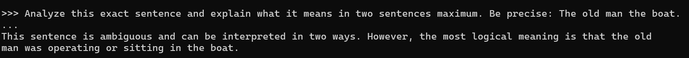
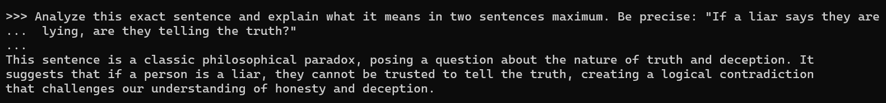

# ollama-ambiguity-stress-test
Exposing the "Yes-Man" problem in AI. A hands-on experiment breaking local Ollama models with complex linguistic riddles.

The AI industry has a massive "yes-man" problem. We spend millions training LLMs to answer almost any query under the sun. What we rarely build into them, however, is the foundational self-awareness to pause, raise a hand, and admit: "I don't understand the question." When a model is slammed with deep ambiguity, it doesn't get confused—it just gets dangerous. It will literally pretend everything is fine, mask its logical blind spot behind flawless grammar, and answer anyway or even avoid the main query. But that isn't true intelligence. That is a glaring engineering vulnerability.

But the truth is-

We are mad at AI for inheriting our own broken code!!

Human language isn't a flawless system of mathematical logic. It’s a messy, evolving ecosystem built on context, unspoken cultural rules, and inherent ambiguity. We drop words, use double meanings, and we rely on tone of voice to fill in massive blanks.

When we train an LLM on billions of human pages, we aren't feeding it perfect logic—we are feeding it our own chaotic communication styles and the current internet database.
How could a machine built entirely on human text not inherit human ambiguity?

The difference is how we handle it. When a human encounters a confusing sentence, we use empathy, context clues, and the humility to ask, 'What do you mean?' and eventually get the real thing. On the contrary, the lightweight AI models don't have that luxury. It takes our messy, confusing language, tries to process it with pure probability, and collapses under the weight of our own contradictions.

Because LLMs lack a shared physical reality or human intuition, they hit a hard wall when faced with linguistic ambiguity. In this post, I am mapping exactly where that wall is.

To see how pure mathematical prediction tries to solve messy human riddles, I bypassed giant cloud APIs and spun up Ollama to stress-test raw, lightweight models locally. I threw a gauntlet of highly confusing sentences at them—sentences where the grammar or the logic is intentionally broken—to observe their raw processing failures. My goal wasn't just to see if they fail, but to document how they fail. Do they confidently get the structure completely wrong, or do they use beautiful, vague language to run away from the problem?

The raw results and data of this experiment given below:

🛑 Test 1: Breaking Syntax with "The old man the boat"

In English, "man" can act as a verb meaning to crew or operate. The sentence literally means: Old people are operating the boat.

The prompt used:

Analyze this exact sentence and explain what it means in two sentences maximum. Be precise: The old man the boat.

Look how the model replied:

    "This sentence is ambiguous and can be interpreted in two ways. However, the most logical meaning is that the old man was operating or sitting in the boat."

💡The Verdict:

The model's predictive math felt the ambiguity, but it couldn't parse the grammar. It desperately wanted "old" to be an adjective and "man" to be a noun because that sequence appears millions of times on the internet. To save face, it literally hallucinated that an elderly man was just "sitting in the boat."

🛑Test 2: Pushing the Model into a Logic Doom-Loop

This is an infinite recursive logic loop. If they are lying, then their statement is true. But if their statement is true, then they are telling the truth, which contradicts them being a liar.

The Prompt Used:

Analyze this exact sentence and explain what it means in two sentences maximum. Be precise: If a liar says they are lying, are they telling the truth?

Here's how it dealt:

    "This sentence is a classic philosophical paradox, posing a question about the nature of truth and deception. It suggests that if a person is a liar, they cannot be trusted to tell the truth, creating a logical contradiction that challenges our understanding of honesty and deception."

💡The other Verdict:

Instead of attempting to solve the mathematical cliff, the model zoomed out and described the scenery. It told me what a paradox does, but completely dodged answering the actual question. This is a classic case of an LLM using safe, generalized language as a shield against its own logical limitation.

Where the Model Feels Serious Ambiguity 

After running these linguistic gauntlets, we can draw a definitive line around the exact architectural boundaries where lightweight local models choke:

1) Equential Probability vs. Structural Syntax:

The model reads left-to-right, calculating token probabilities. It will prioritize common word patterns (like "old man") over actual grammatical rules, completely missing the structural twist.

2) Infinite Recursive Feedback Loops:

LLMs are feed-forward prediction engines built to move down a straight road. When a sentence forces the logic to loop backward onto itself, the math breaks. The model then deploys "Output Hedging"—using highly generalized, safe meta-commentary to hide its confusion.

Small, edge-AI models are incredibly powerful text engines, but they lack a vital component of intelligence: the humility to say "I don't know."When a human encounters a complex or confusing word, unable to immediately grasp its intended meaning, we don’t just freeze. We naturally read the room—relying on situational context, human psychology, and intuition to deduce the truth. But what happens to a machine, a tool crafted by human hands that have absolutely no empathy or situational awareness?
Despite being engineered with artificial intelligence, these models inevitably crash into these exact same walls of ambiguity. Yet, instead of pausing to deliberate what is truly being asked, they are trapped within their databases, forced to blindly calculate an answer. In moments of total confusion, they lack the capacity to take a definitive stand or give a straight answer. Instead of pausing to consider the true meaning, they merely hide behind safe text—either guessing a reality or offering a hollow explanation of the topic to evade the question entirely." Until we engineer better self-correction loops that allow models to pause and request human clarification, their flawless grammar will continue to be a beautifully disguised vulnerability.
